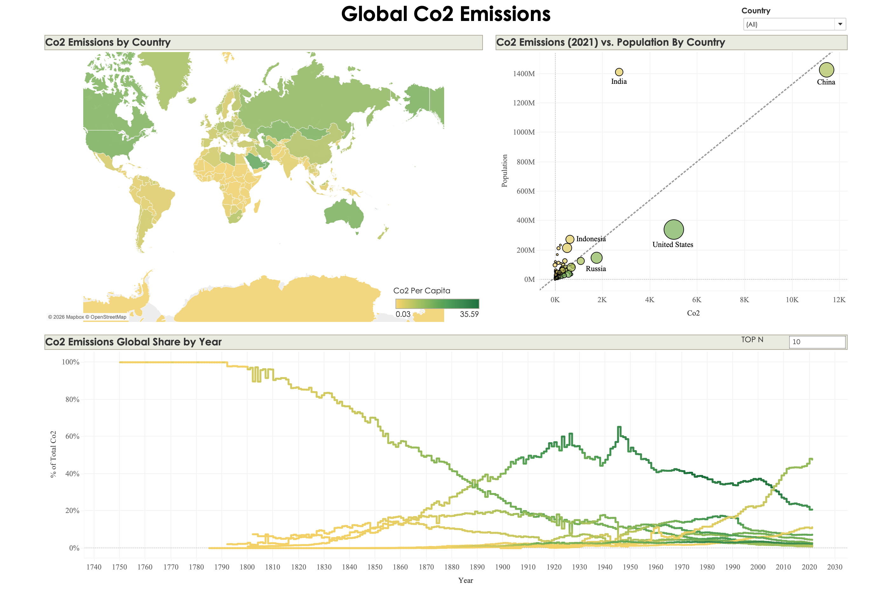

# Global CO2 Emissions | Tableau Dashboard

I built this interactive Tableau dashboard to explore how CO2 emissions vary between countries and how their share of emissions has changed over time.

I wanted to look beyond total emissions and compare countries from different perspectives, including emissions per person, population size, and historical trends.

## Dashboard preview

## Questions explored

- How do CO2 emissions per person differ across countries?
- How do total emissions compare with population size in 2021?
- How has each country's share of emissions changed over time?

## Dashboard features

### Emissions per person map

A world map coloured by CO2 emissions per capita. This makes it easier to compare emissions relative to population rather than relying only on country totals.

### Emissions and population comparison

A scatter plot comparing CO2 emissions with population in 2021. Labels highlight countries such as China, India, the United States, Russia, and Indonesia.

### Historical emissions share

A line chart showing changes in countries' percentage share of emissions over time. A Top N control allows users to adjust how many countries are included.

### Interactive controls

The dashboard includes a country filter and a Top N parameter to help users explore specific countries and compare trends.

## Main observations

- China has the highest total CO2 emissions among the countries shown in the 2021 scatter plot.
- India and China have similarly large populations, but their total emissions differ considerably.
- The United States has a much smaller population than India, yet higher total emissions in the 2021 comparison.
- Total emissions and emissions per person provide different perspectives. Both are useful when comparing countries.

These comparisons show that population size alone does not explain differences in emissions. The dashboard helps explore the relationship, but it does not establish what causes those differences.

## Skills practised

- Building geographical visualisations in Tableau
- Comparing measures using scatter plots
- Presenting historical data with line charts
- Adding filters and parameters
- Combining multiple views into an interactive dashboard
- Communicating findings through data visualisation

## Tools used

- Tableau

## Interpreting the dashboard

Total CO2 emissions, emissions per capita, and percentage share measure different things and should be read separately.

A country's falling percentage share does not necessarily mean its actual emissions have fallen. Its share may also decline because emissions elsewhere have grown.

When using the country filter or Top N control, check how the percentage calculation responds before interpreting the historical chart as a share of the global total.

## Project credit

I completed it to practise Tableau and develop my dashboard-building skills. Credit for the guided project and learning materials goes to Maven Analytics.

## Author

Hassan Ijaz  
MSc Data Analytics, University of Huddersfield
